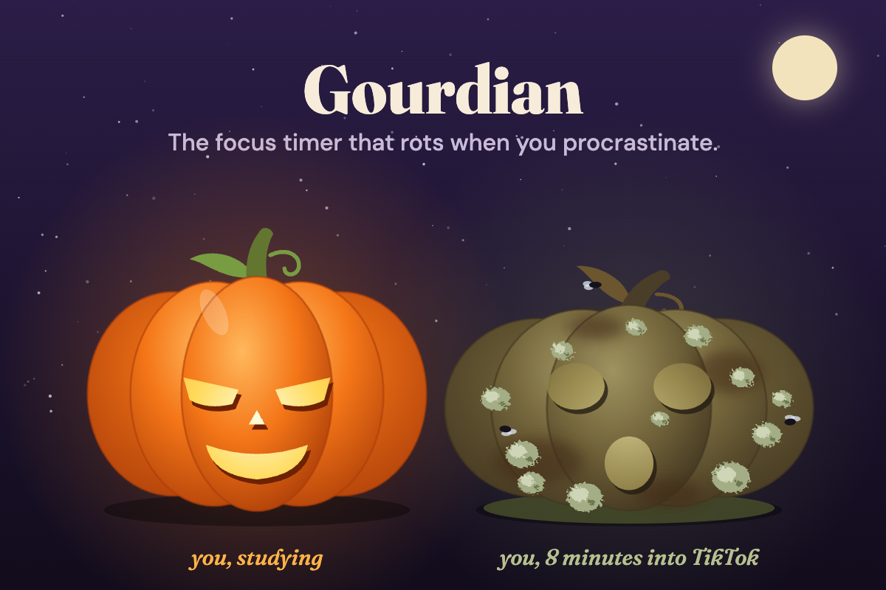

# Gourdian 🎃

**The focus timer that rots when you procrastinate.**

Start a session and Jack the pumpkin watches your tab. Wander off to TikTok and Jack starts to rot in real time:
mold spots, a sagging body, flies, a puddle of goo. The tab title starts guilt-tripping you ("🎃 you left me on read"),
and the favicon rots in your tab bar. When you come back, you have to confess where you went.

Built for **Pumpkin Playground** (CSULB ACM, fall 2026).



## Try it

- Live: https://ashank-crazy.github.io/gourdian/
- Locally: `python3 -m http.server 8642` in this folder, then open http://127.0.0.1:8642

No install, no accounts, no build step. Everything is stored in your browser's `localStorage`.

## How it works

| You do | Jack does |
| --- | --- |
| Start a 1, 15, 25, 50 or custom-minute session | Watches your tab, heals a little every minute you stay |
| Leave the tab for more than 10 s | Rots about 12% per minute. The title and favicon update live |
| Come back | Asks where you went: Instagram, TikTok, YouTube, texting, games, shopping, snacks, the void… |
| Say "working in another tab, I swear" | Undoes the rot. Twice per session. After that, half credit and a squint |
| Finish the session | Gives you a graded report card (A+ "Prize Pumpkin" to F "Compost") and offers a 5-minute break |
| Skip studying for days | Rots 8% per day of neglect |
| Hit 100% rot | Dies. You get an obituary with the cause of death, and the pumpkin goes to the graveyard |

Each pumpkin grows with its focus time: Tiny Gourd → Pie Pumpkin → Jack-o'-Lantern → Prize Pumpkin (blue ribbon) →
Honor-Roll Pumpkin (grad cap) → Gourd-zilla (crown). When one dies, its progress goes with it.

**Stats** shows total focus, streak, recent sessions with grades, and **Pumpkin killers**: a ranking of where your
time actually went, built from your own confessions. **Graveyard** keeps a tombstone for every pumpkin you've lost.

Report cards and obituaries save as 1080×1350 images, sized for Instagram stories. On phones they open the share sheet.

### Extras

- Click Jack for a poke (and a complaint). The carved face follows your cursor.
- The bell button turns on notifications: one nag after a minute away, and a ping when the timer or a break ends.
- `?demo` speeds rot up (3 s grace, 60%/min) and adds a 10-second session, which helps when recording a demo.

## Under the hood

- Vanilla HTML, CSS and JavaScript modules. No frameworks, no dependencies.
- Jack is generated SVG (`js/pumpkin.js`): one pure function of rot, mood, and growth stage. The same function draws
  the page, the graveyard, the share cards, and a canvas version for the favicon.
- Leaving and returning use the Page Visibility API. A Web Worker keeps the clock ticking in background tabs,
  where browsers throttle normal timers to once a minute.
- If you close the tab mid-session, the time it was closed counts as time away when you come back.
- Sound effects are synthesized with the Web Audio API, so there are no audio files.
- Fonts: Fraunces and DM Sans from Google Fonts.

## Files

```
index.html         page structure
styles.css         all styling (night sky, cards, dialogs, responsive rules)
js/app.js          state, timer, visibility handling, confessions, stats, share cards
js/pumpkin.js      Jack: SVG renderer and favicon renderer
js/lines.js        everything Jack says, plus grades, growth stages and causes of death
js/sound.js        Web Audio sound effects
media/             social preview, Devpost gallery images
```

## Credits

Made by ashank-crazy for Pumpkin Playground. Built with help from Claude Code (Anthropic).
